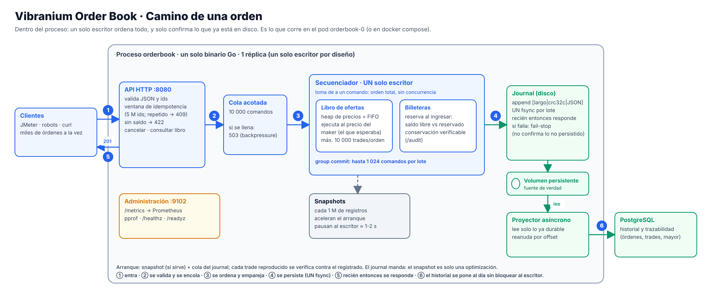

# Vibranium Order Book

Libro de ofertas para negociar **Vibranium en reales (BRL)**, hecho en Go. Desafío técnico de Mercado Libre (Cloud & Platform).



**Idea central:** un libro de ofertas no admite concurrencia, así que **un solo escritor** ordena todas las órdenes y solo confirma lo que ya está en disco (journal con un `fsync` por lote). Las lecturas e historial salen de Postgres sin frenar al escritor.

## Levantarlo (necesitas solo Docker)

```bash
docker compose up --build -d     # la primera vez compila y descarga imágenes (unos minutos)
./scripts/smoke.sh               # termina con SMOKE OK si todo funciona
```

| | |
|---|---|
| API | http://localhost:8080 |
| Grafana (dashboard) | http://localhost:3000 |
| Prometheus y alertas | http://localhost:9090 |

Si algún puerto está ocupado, copia `.env.example` a `.env` y cambia solo ese número. En Windows usa Git Bash. Guía completa: [docs/EJECUTAR_LOCAL.md](docs/EJECUTAR_LOCAL.md).

## Probarlo a mano

```bash
curl -XPOST localhost:8080/deposits -d '{"user_id":"alice","brl":100000}'      # primero hay que fondear (centavos)
curl -XPOST localhost:8080/deposits -d '{"user_id":"bob","vib":50}'
curl -XPOST localhost:8080/orders   -d '{"id":"s1","user_id":"bob","side":"SELL","price":900,"qty":4}'
curl -XPOST localhost:8080/orders   -d '{"id":"b1","user_id":"alice","side":"BUY","price":1000,"qty":10}'
curl localhost:8080/balances/alice
curl localhost:8080/audit        # verifica que los saldos cuadran
```

Carga a 5.000 órdenes/s con auditoría de saldos al final (corre dentro de Docker):
`docker compose run --rm loadgen -rate 5000 -duration 30s`

## Contrato de la API (lo que necesita quien la pruebe)
| Endpoint | Cuerpo / uso | Respuestas |
|---|---|---|
| `POST /deposits` | `{"user_id","brl","vib"}`: **primero hay que fondear las billeteras**; el sistema no tiene registro de usuarios | 204 · 400 |
| `POST /orders` | `{"id"?,"user_id","side":"BUY"\|"SELL","price","qty"}` | 201 (orden + trades) · 400 · 409 id ya procesado · 422 sin saldo · 503 cola llena |
| `DELETE /orders/{id}` | cancela y libera lo reservado | 200 · 404 |
| `GET /balances/{user}` | saldo libre y reservado en BRL y VIB | 200 |
| `GET /book?depth=N` | niveles agregados (N ≤ 100) | 200 |
| `GET /audit` · `GET /audit/history/{user}` | verifica invariantes · compara el saldo del motor con el recalculado desde el historial | 200 |
| `GET /orders/{id}` · `/orders` · `/trades` | historial en Postgres (consistente a los pocos ms) | 200 · 404 · 503 |

**Unidades y reglas:** `price` en **centavos de real** por unidad de Vibranium y `qty` en unidades, ambos **enteros** (un decimal da 400).
`id` de orden y `user_id`: **1-64 caracteres entre `[A-Za-z0-9._:@+-]`** (si no, 400 `invalid_id`). Si se omite el `id`, el servidor genera uno; **enviarlo** permite reintentar sin duplicar (409 si ya se procesó).
Una orden **ejecuta como máximo 10.000 trades**: si todavía hubiera precios compatibles, el remanente se **cancela** (estado `CANCELLED` con `filled` > 0) y se libera lo reservado.
**Seguridad (MVP):** la API no tiene autenticación; los puertos de Postgres, Prometheus, Grafana y métricas solo escuchan en `127.0.0.1` y sus claves (`orderbook`, `admin/admin`) son de demo local.

## Qué leer (en este orden)

1. [docs/DECISIONES.md](docs/DECISIONES.md): el diseño, su motivación y las limitaciones conocidas.
2. [docs/DEFENSA_TECNICA.md](docs/DEFENSA_TECNICA.md): arquitectura, invariantes, qué pasa si algo falla, rendimiento medido y riesgos.
3. [docs/OBSERVABILIDAD.md](docs/OBSERVABILIDAD.md): métricas, 13 alertas y dashboard.
4. [docs/INFORME_PRUEBAS.md](docs/INFORME_PRUEBAS.md): qué se probó y con qué resultado.
5. **Kubernetes e infraestructura como código:** repositorio `vibranium-orderbook-infra` (cluster, ingress, pruebas de caos).

Índice completo de la documentación: [docs/README.md](docs/README.md). Comandos de resiliencia y pruebas sin Docker: [docs/COMANDOS.md](docs/COMANDOS.md).
