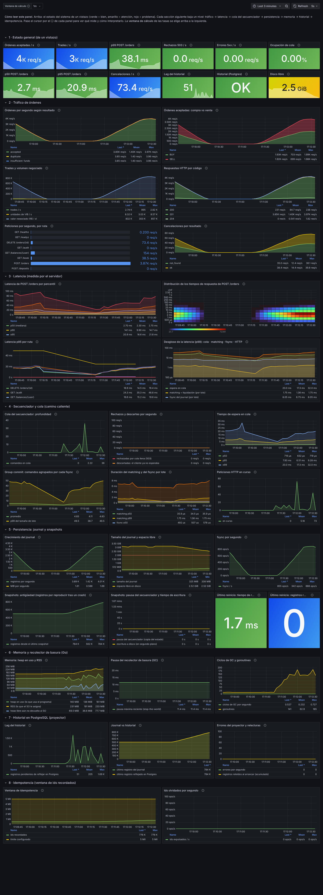

# Observabilidad


*Dashboard «Vibranium Order Book — Panel de control» durante una carga con JMeter (≈ 4.000 órdenes/s con validación de negocio).*

## ¿Prometheus o Grafana? Los dos, porque hacen cosas distintas
| | **Prometheus** | **Grafana** |
|---|---|---|
| Rol | **Recoge y guarda** las métricas (base de series de tiempo) y **evalúa las alertas** | **Dibuja** las métricas en dashboards |
| Cómo funciona | Cada 5 s lee `GET /metrics` de la app y almacena los valores | Consulta a Prometheus (u otra fuente) y las visualiza |
| Por sí solo | Tiene una UI mínima | No guarda nada: necesita una fuente de datos |

Flujo: **app → `/metrics` → Prometheus → Grafana**. Es la combinación más extendida en entornos corporativos: Grafana como estándar de dashboards, normalmente sobre Prometheus o sus versiones escalables (Mimir, Thanos).
**Por qué es una decisión segura:** el *formato de Prometheus* es un estándar abierto que casi cualquier plataforma sabe leer (colectores de OpenTelemetry, Datadog, etc.). Si la empresa evaluadora usa otra herramienta, estas métricas siguen siendo válidas; solo cambia quién las dibuja. *(No se asume qué usa internamente Mercado Libre: es una buena pregunta para el equipo.)*

## Cómo verlo (con `docker compose up -d`)
| Qué | Dónde |
|---|---|
| Dashboard | http://localhost:3000 (abre directo, sin login; para editar: `admin` / `admin`) |
| Prometheus y alertas | http://localhost:9090 · http://localhost:9090/alerts |
| Métricas crudas | http://localhost:9102/metrics (puerto de **administración**, solo accesible desde tu máquina) |
| Perfiles de CPU/memoria (pprof) | http://localhost:9102/debug/pprof/ |
| Estado para el balanceador | `GET :8080/healthz` (vivo) · `GET :8080/readyz` (listo) |

Generar tráfico para ver el dashboard moverse (no requiere Go):
```bash
docker compose run --rm loadgen -rate 5000 -duration 30s
```

## El dashboard de Grafana (43 paneles en 8 secciones)
Se genera con `python3 ops/grafana/generate_dashboard.py` (las consultas PromQL se revisan como código) y se provisiona solo desde `ops/grafana/dashboards/orderbook.json`. Arriba hay un selector de **ventana de cálculo** (30 s, 1 m, 5 m) que usan todas las tasas y percentiles. Cada panel tiene un ⓘ con qué mide y cómo leerlo, y las gráficas muestran en la leyenda el **último valor, el promedio y el máximo** del periodo.

| Sección | Qué responde |
|---|---|
| 1 · Estado general | 12 indicadores en verde/amarillo/rojo: órdenes/s, trades/s, p50/p95/p99, rechazos 503, errores 5xx, ocupación de cola, cancelaciones, lag del historial, estado de Postgres, disco libre |
| 2 · Tráfico de órdenes | órdenes por resultado, compra vs venta, trades y volumen (unidades y R$), respuestas por código HTTP, uso por ruta, cancelaciones |
| 3 · Latencia | percentiles p50→p99.9, mapa de calor de la distribución, p95 por ruta, desglose cola · matching · fsync · HTTP |
| 4 · Secuenciador y cola | profundidad, rechazos/descartes, espera en cola, group commit, duración de matching y fsync, peticiones en curso |
| 5 · Persistencia | crecimiento y tamaño del journal, espacio libre, fsync/s, antigüedad y pausa de los snapshots, tiempo de recuperación |
| 6 · Memoria y GC | heap y RSS, pausa del GC, ciclos de GC y goroutines |
| 7 · Historial en Postgres | lag, journal vs historial, errores y relecturas del proyector |
| 8 · Idempotencia | ventana de ids recordados y expulsiones |

## Catálogo de métricas (cada una responde una pregunta)
| Métrica | Pregunta que responde |
|---|---|
| `orderbook_orders_total{side,result}` | ¿Cuántas órdenes entran y cuántas se rechazan, y por qué? (`accepted`, `insufficient_funds`, `duplicate`, `invalid`, `overloaded`, `timeout`) |
| `orderbook_trades_total`, `traded_units_total`, `traded_value_cents_total` | ¿Cuánto se está negociando? |
| `orderbook_http_request_duration_seconds{route}` | ¿Qué latencia ve el cliente? (histograma → p50/p95/p99) |
| `orderbook_http_requests_total{route,method,code}` | ¿Qué códigos devolvemos? (201, 409, 422, 503, 5xx) |
| `orderbook_queue_depth` / `queue_capacity` | ¿Está saturado el secuenciador? |
| `orderbook_queue_rejected_total` | ¿Estamos aplicando backpressure (503)? |
| `orderbook_queue_wait_seconds` | ¿Cuánto espera una orden antes de ejecutarse? |
| `orderbook_batch_size` | ¿Cuántas órdenes comparten un fsync (group commit)? |
| `orderbook_journal_fsync_seconds` | ¿El disco es el cuello de botella? |
| `orderbook_batch_exec_seconds` | ¿Cuánto cuesta el matching en memoria? (casi nada) |
| `orderbook_journal_last_seq`, `journal_bytes`, `journal_syncs_total` | Ritmo y tamaño del journal |
| `orderbook_projector_lag`, `projector_up`, `projector_failures_total` | ¿El historial está al día? ¿Postgres está bien? |
| `orderbook_projector_rescanned_records_total` | Al arrancar: 1 = el proyector reanudó por offset; ≈ todo el journal = tuvo que releerlo (offset inservible o historial antiguo) |
| `orderbook_snapshot_age_records` / `snapshot_pause_seconds` / `snapshot_write_seconds` / `snapshot_failures_total` | ¿Cuánto habría que reproducir en un reinicio? ¿Cuánto frena el snapshot al secuenciador? |
| `orderbook_recovery_seconds` / `recovery_replayed_records` | ¿Cuánto tardó el último arranque y qué reprodujo? |
| `orderbook_queue_expired_total` | ¿Se descartan comandos porque el cliente ya no esperaba? (latencia > plazo) |
| `orderbook_journal_disk_free_bytes` | ¿Cuánto disco queda para el journal? |
| `orderbook_idempotency_window_size` / `_limit` / `idempotency_evicted_total` | ¿Cuántos ids recuerda la idempotencia y cuántos se olvidan? (memoria acotada) |
| `go_*`, `process_*` | Goroutines, memoria, GC, CPU, descriptores |

**Cardinalidad acotada (importante en producción):** la etiqueta `route` usa el *patrón* (`GET /orders/{id}`), no la URL real; mil `order_id` distintos no crean mil series (hay un test que lo verifica).

## Alertas (`ops/prometheus/alerts.yml`, 13 reglas)
| Alerta | Condición | Significa |
|---|---|---|
| `OrderbookDown` | `up == 0` 30 s | La app no responde |
| `QueueNearlyFull` | cola > 80 % 1 min | El matching no da abasto: pronto habrá 503 |
| `BackpressureActive` | hay rechazos 503 1 min | Se están rechazando órdenes |
| `FsyncSlow` | p99 fsync > 50 ms 2 min | El disco frena a todas las órdenes |
| `OrderLatencyHigh` | p99 `POST /orders` > 250 ms 2 min | Latencia degradada |
| `ServerErrors` | hay 5xx/504 1 min | Errores reales (el 503 de backpressure se trata aparte) |
| `ProjectorDown` | proyector no sano 1 min | El **historial** se atrasa; el **mercado no** |
| `ProjectorLagging` | lag > 10.000 2 min | Historial muy atrasado |
| `SnapshotFailing` | falló un snapshot en 10 min | No se pierde nada, pero el próximo reinicio sería lento |
| `JournalDiskLow` | < 2 GiB libres donde vive el journal, 2 min | Con el disco lleno el servicio hace fail-stop |
| `JournalDiskFillingUp` | el disco se llena en < 6 h (`predict_linear`), 10 min | Hay que archivar/rotar o ampliar el volumen |
| `ExpiredCommands` | se descartan comandos cuyo cliente ya no esperaba, 1 min | La espera en cola supera el plazo de 2 s; esas órdenes NO se ejecutan |
| `SnapshotStale` | > 1.000.000 registros sin snapshot, 5 min | Un reinicio ahora reproduciría esa cola (~8 s por millón) |

Se evalúan en Prometheus y se ven en `/alerts`. **Cada regla tiene pruebas unitarias** (`./scripts/test-alerts.sh`, `promtool test rules` con series sintéticas: un caso que DEBE dispararla y, cuando importa, otro que NO). En producción irían a **Alertmanager → Slack/PagerDuty** (fuera del MVP).

## Logs
JSON estructurado por línea (`docker compose logs orderbook`). Cada request lleva `X-Request-ID` (se propaga o se genera) y aparece en los logs.
Con 5.000 req/s **no se loguea cada request**: solo lo anómalo (5xx distinto de 503, o más de 250 ms) a nivel `warn`. `LOG_LEVEL=debug` activa el detalle completo (una línea por request y por orden con `order_id`, `user_id`, estado y trades).

## Salud vs. disponibilidad
- `/healthz`: el proceso está vivo (para reiniciarlo si se cuelga).
- `/readyz`: puede recibir tráfico (el secuenciador está activo). **Postgres no es requisito** (decisión D40): si cae, el mercado sigue; solo el historial degrada.

## Generador de carga (`cmd/loadgen`)
Órdenes aleatorias alrededor de un precio medio (para que crucen), ritmo objetivo configurable, y al final **verifica `/audit`**: si los saldos no cuadran, termina con error.
La latencia se mide desde el instante en que la request **debió salir**, no desde que salió (*open loop*): así, si el servidor se atrasa, el retraso se refleja y no se oculta (*coordinated omission*).
```
docker compose run --rm loadgen -rate 5000 -duration 30s -workers 128 [-users 100 -cancel 0.05]
```

## Resultados medidos (con honestidad sobre las condiciones)
Entorno: **máquina de 4 núcleos compartida** entre el generador, la app, Postgres, Prometheus, Grafana y Docker. Disco virtual (fsync muy rápido).

| Prueba | Órdenes/s | Resultado |
|---|---|---|
| Limpia, generador en Docker | **5.000** × 30 s (150.000 órdenes) | 100 % aceptadas · **p50 1,2 ms · p99 16 ms · p99,9 39 ms · máx 57 ms** · saldos cuadran |
| Limpia, generador en el host | 5.000 × 30 s | p99 29 ms · máx 74 ms · saldos cuadran |
| Con tareas pesadas simultáneas (navegador para capturas) | 5.000 × 40 s | 100 % aceptadas, saldos cuadran, **pero p99 252 ms** |
| Con parada/arranque de Postgres a mitad | 3.000 × 45 s | 100 % aceptadas, saldos cuadran; máx. latencia 825 ms |

**Lectura honesta:** las colas largas aparecieron cuando había otra actividad pesada en la misma máquina de 4 núcleos (el servidor midió 185 requests > 250 ms en la prueba con Postgres, sin que `fsync`, matching ni cola lo expliquen). Es compatible con contención de CPU del entorno, pero **no está demostrado**; hay que repetirlo en la máquina de la presentación y, si persiste, perfilar con `pprof`. Lo que sí es robusto: **ninguna orden se perdió, ningún saldo se descuadró y el sistema nunca devolvió un error**, en todas las pruebas.
CPU a 5.000 órdenes/s: app ≈ 1,3 núcleos, Postgres ≈ 0,7, generador ≈ 0,65.

## Capacidad medida (escalón de carga)
Todas las órdenes aceptadas y saldos auditados en cada escalón; 4 núcleos compartidos con el generador, Postgres, Prometheus y Grafana.

| Objetivo | p50 | p99 | Cola máx. |
|---|---|---|---|
| 5.000/s | 1,2 ms | 16 ms | – |
| 8.000/s | 1,5 ms | 146-200 ms | 16 |
| 12.000/s | 2,8 ms | 199 ms | 16 |
| 16.000/s | 9,1 ms | 140 ms | 22 |

El límite es el CPU total de la máquina (la cola casi no se usa): ver el perfil en [DEFENSA.md](DEFENSA.md#fase-6--escala-recuperación-acotada-y-cierre).

## Cómo diagnosticar (mini-runbook)
| Síntoma en el dashboard | Mirar | Causa probable |
|---|---|---|
| Sube la latencia p99 | "Tiempo de espera en cola" vs "fsync p99" | cola alta ⇒ matching/CPU saturado; fsync alto ⇒ disco |
| Aparecen 503 | Cola llena | Más tráfico del que procesa un secuenciador: particionar por instrumento |
| Lag del historial crece | Panel "Proyector" + `projector_up` | Postgres caído o lento; el mercado sigue sano |
| 5xx / 504 | Logs `warn` con `request_id` | Error real o timeout: investigar |
| Memoria/goroutines crecen | "Runtime de Go" + `pprof` | Fuga o carga sostenida |

## Siguientes pasos (backlog en `MEJORAS.md`)
Trazas distribuidas (OpenTelemetry), Alertmanager con enrutamiento, SLOs con *burn rate*, ejemplares (*exemplars*) para saltar de una métrica lenta a su traza, y métricas de negocio por instrumento al particionar el mercado.
